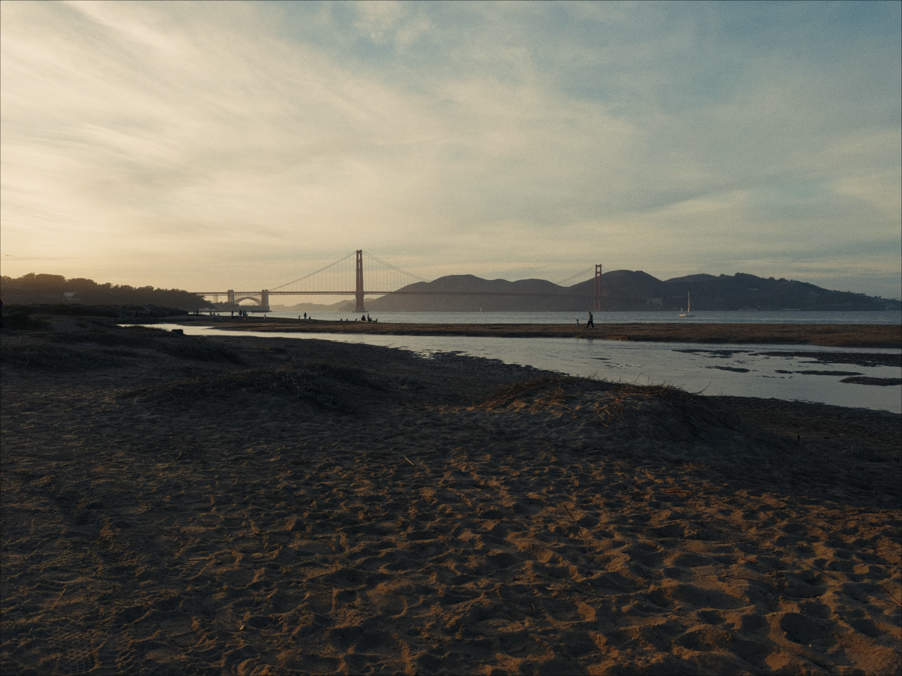

I've been running since I was 15. I started to run when I first got heartbroken, as a way to get over it. It was tough. I grew up with rhinitis and struggled to breathe properly, not to mention I wasn't in shape. Yet, there was something satisfying to the struggle. It felt worth enduring. Virtuous.

So I stuck with it. Since, it's become my way of exploring the world. In Tokyo, I ran in beautiful Shibuya in the early mornings. In San Francisco through the Marina. In New York through Williamsburg Bridge. My only exception was India, where the streets were too crowded.

Recently, I ran New York style for the first time in San Francisco: shirtless and in shorts[^1]. Aside from being hyper-aware of the attention you get running that way, I was finding the run strange, because I had run the route I planned so quickly that I didn't know what to do.

So I asked myself: should I go back, doing an OK distance, or keep going, to a part of the city I hadn't gone to before? It was getting cold and I knew it'd get chilly without a shirt. In that instant, I don't think it was my conscious self that made the choice to keep going.

There is a part to us humans that wants to keep going[^2]. It's the part that makes you talk to a stranger at an event, or negotiate a deal when buying something from a friend. We're alive when we push ourselves where we haven't been. It's animalistic, really.

That part of me made the choice that day. I knew the consequences well. That it'd get dark. That I'd be freezing soon. That my knee would start to hurt at some point, making me slower and look a bit silly. And that I might have to spend money on a taxi back home if I couldn't see it through.

If you've studied psychoanalysis, you know this "part" I'm describing is what Jung would describe as the shadow. Things you'd like to do and ways you'd like to be that don't fully fit in with the constraints of reality or your own perception.

Though, often, like in this run, it's right. Following it led me to see some beautiful beaches in what I now know is the Golden Gate Beach. I ran five miles — roughly 8 km — in about an hour and got back home before dark.

These kinds of experiences make me question my shadow. It's counterintuitive: why does what I know might hurt me make me live better? Like a shy person at a housewarming party that wants to chat but is afraid, I sometimes evaluate its (my?) impulses.

I haven't figured it out. I figure it's my survival instinct. My best assimilation of it is this quote from the movie No Time to Die (2021): "The proper function of man is to live, not to exist. I shall not waste my days in trying to prolong them. I shall use my time."

Granted, there are other times my impulses have been less successful. Like when I braked too hard in the rain to take a picture of a pretty scene and my scooter went drifting into the pavement. Those times scare me of my shadow.

But most of the time, it helps more than it hurts. I'm ultimately grateful to have it. I wouldn't have met a lot of people I care about if I hadn't followed it. Nor would I have great runs like the one I described above.[^3]

I therefore associate achieving one's potential with chasing one's shadow. I think, as much as we'd sometimes like to, it's impossible to deny our nature. We want to run farther; to see what lies on the other end. It doesn't always work out, but if we're alive, we might as well act like it!

[^1]: If you want to understand why I call this New York style, all it takes is a scroll through the parks in the Hudson river during the summer. In hindsight, it's rather aerodynamic. 

[^2]: Though now it's not just humans reading this, is it. 

[^3]: As a friend recently put it to me: you're human, so you might as well experience it to the fullest. 
